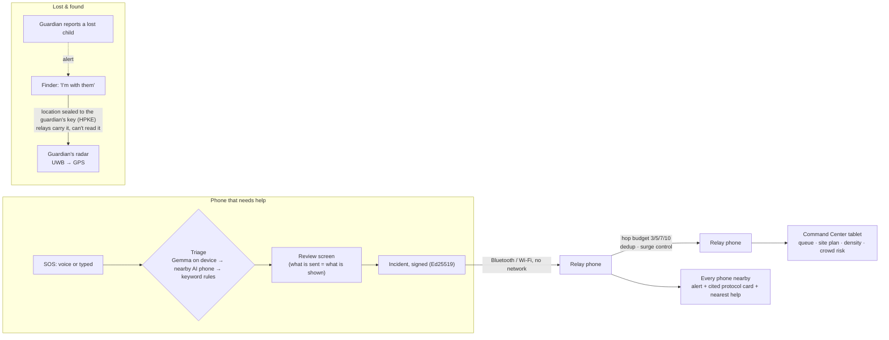

# Proxima

**Offline, phone-to-phone safety network for big crowds in Mauritius.** When tens of thousands gather at
Ganga Talao for Maha Shivaratri, at Ganesh Chaturthi, concerts or on campus, mobile networks collapse.
Proxima lets people raise and route emergencies, find lost children and get guided help with **no network at all**.

> Hackathon *Life Powered by Tech*, 13–14 Nov 2026 · Theme 1: **Powered to Protect**

## Problem & user

**Hero user: a parent with a young child on the Maha Shivaratri pilgrimage to Ganga Talao (Grand Bassin).**
Tens of thousands of people, cell networks congested or dead, and the child gets separated. Today there is no
way to alert the people standing next to you, and no way to find the child once somebody has them.

The same gap hits anyone who *sees* an emergency — a collapse, a fire, a fallen branch, a crush building — at
Ganesh Chaturthi, Père Laval, concerts, rallies and university campuses: they cannot call for help and cannot
warn the crowd around them.

**Why "offline" is the whole point.** Our own dataset makes the case. At Ganga Talao the nearest medical
facility is **8.5 km away**, the nearest police station 8.5 km, the nearest fire station 10.7 km. Help is not
around the corner, and the network you would use to call it is the first thing to fail.

## How it works

Everything is one `Incident` on one pipeline — lost person, sighting, found, medical, hazard, all-clear.

1. **One-button SOS (voice or tap).** On-device AI turns panicked speech into a ~200-byte structured incident
   (type, severity, landmark). A rules-based classifier (`RuleTriageEngine`, keywords in English, French and
   Kreol Morisien) runs on every phone as the fallback, so the feature never depends on a model loading.
2. **Multi-hop mesh.** The incident is **signed (Ed25519)** and relayed phone to phone over Bluetooth / Wi-Fi with
   no network. A node's id is derived from its key, so an altered alert, or one claiming someone else's id, is
   rejected. Severity sets the hop budget (3 / 5 / 7 / 10); duplicates are dropped by packet id.
3. **Guided response.** The incident resolves to a **vetted protocol card with a cited source**, read aloud,
   plus the **nearest real help point** from the Mauritian dataset with distance and bearing.
4. **Lost & found, privately.** The guardian reports a lost child — minimal description, **no name, no photo**.
   A finder who is with the child answers that alert, and the location travels **sealed to the guardian's key**,
   so relays carry it but cannot read it. The guardian then gets a radar pointing the way.
5. **Command Center** (tablet at a first-aid or police post): live incident heatmap from **anonymous grid
   cells only**, mesh topology, and merged report counts ("Fire — 15 reports").
6. **My people (friend find).** Friends pair once by comparing a six-digit number on both screens. Each phone's
   beacon then carries a tag that changes every 10 minutes and that only its paired friends can recognise. If a
   friend can't call for help, your phone spots their tag in beacons it already hears and shows the 25 m square
   their phone was last heard in, with the radar to it. **Nobody broadcasts a search**, so no relay or bystander
   learns that anyone is being looked for. *Tested on two real phones (S24 Ultra ↔ Galaxy A56, 14 Nov): they paired
   by matching code and each then recognised the other from its rotating beacon tag. The radar to a friend needs a
   GPS fix or UWB; indoors with neither, the screen asks you to step outside.*
7. **Verified posts.** A medic tent's or steward's phone carries a pass signed by the event organiser. Every phone
   checks that signature together with the beacon it arrived in, then shows the post, live, in "Nearest help" and
   on the Command Center plan. At Ganga Talao the nearest medical facility is 8.5 km away; a medic tent is not.
   *Tested on real phones (14 Nov): the organiser's laptop signed a 12-hour "Medic tent 2" pass for the Honor X8b,
   delivered over adb (the organiser's private key never leaves the laptop). The Honor showed "Verified role: Medic
   tent 2", and a medical report on the S24 Ultra listed "Medic tent 2 — Medic on site now, verified by the
   organiser" first in Nearest help, 5 m away, above the nearest clinic (506 m).*

**Tested end to end on real phones, simulation off** (14 Nov, 5 devices: S24 Ultra, S26+, S23+, Galaxy A56,
and a Galaxy Tab S6 Lite as Command Center). Every step passed:
- **SOS → Command Center:** a typed medical report reached every phone and the tablet, *Signature: Verified*.
- **Forced two-hop relay** (A56 → S24 Ultra → tablet): the same packet arrived one hop later with its signature
  still valid.
- **Lost & found with real encryption:** guardian (S23+) reported a lost child, finder (S26+) answered, and the
  guardian got *"Someone is with your child"* plus the radar (UWB with a direction arrow up close, then GPS).
  The three bystander devices relayed the finder's sealed updates (23 in total) and **none could open them**.
- **On-device AI triage:** Gemma on the S24 Ultra sorted a bleeding report in 1.4 s, and the tablet showed exactly
  what the sender's review screen showed.
- **Friend find:** see item 6.

**The radar, honestly: what works on which phone** (measured 13 Nov, simulation off, real mesh)
| Source | Phones | What we measured |
|---|---|---|
| **UWB** (centimetre ranging) | Samsung S23+, S24 Ultra, S26+ (UWB flagships) | Distance ±0.1 m at 2 m, ±0.3 m at 5 m. Over the real mesh (S23+ → S26+) the first fix arrives 0.5 s after "find", then ~3 per second, no pairing screen. **Direction arrow only on the S23+**: the S24 Ultra reports no angle-of-arrival, and the S23+'s angle is approximate (a target 45° to the side reads ~30–40°), so we smooth it and hide the arrow below 0.5 m. Outdoors it took over from GPS at 10.8 m and pointed within 5° on the walk in. |
| **GPS + compass** | Every phone | Position every 1 s; compass corrected to true north (Mauritius declination ≈ −18°). Two phones outdoors: distance within GPS error (±6 m) of a paced walk, bearing steady to ±1°, and at one spot the arrow pointed within 5°. **Limit:** at another spot the S23+ compass read ~70° off, and the phone gave no warning (its accuracy flag stayed "high"), so the app can't detect it. Fix: wave the phone in a figure-8 to recalibrate. Poor indoors, so the stage demo uses UWB, which needs no compass. |
| **Signal strength** ("warmer / colder") | — | **Not available on real phones**: Google Nearby Connections does not expose RSSI, so this fallback only runs in simulation. Without UWB or GPS the radar shows "searching". |

The same radar also points to the nearest help point in guided response (GPS + compass; a help point is just a
target that never moves).

**The mesh, honestly: what we measured on phones** (13 Nov, simulation off, airplane mode with Bluetooth + Wi-Fi on)

Every phone runs Google Nearby Connections (`P2P_CLUSTER`), advertising and discovering at the same time. A packet is
dropped if its id was seen before (Room table, so this survives a restart). Otherwise it is shown and forwarded to every
*other* neighbour, with `ttl − 1` and the relay appended to its path, so it never travels back the way it came.
| What | Phones | What we measured |
|---|---|---|
| **Link** | S26+ ↔ S23+ | First connection ~6 s after launch; packets both ways in ~0.2 s |
| **Multi-hop** | S26+ → Honor X8b → S23+ | Chain forced with a neighbour allow-list (so it also works with all phones in one room). Relayed packets arrive with `hops=1` in **0.09–0.17 s**. This was a 3-phone chain with **one relay**. Hop budgets 3 / 5 / 7 / 10 by severity are unit-tested but **not measured beyond one relay**. |
| **Screen off** | Honor X8b as relay | Kept relaying with its screen off (tested ~80 s, Doze), thanks to a foreground service |
| **Recovery** | 2–3 phones | Radio off for 15 s: link back in **31 s**. Peer app restarted: reconnected under its new id in **7 s**. |
| **Store-and-forward** | 2 phones | Live alerts are kept 30 min and re-sent, most severe first, to any phone that connects later. **Confirmed after an app restart.** |
| **Dedup** | (unit tests) | A seen packet id is dropped, including after a restart. Unit-tested; we did not count duplicates separately on phones. |
| **Acoustic fallback** (off by default) | S26+ → S23+ | With no radio link at all, a 16-byte SOS is sent as **near-ultrasound (18.0 / 18.7 kHz)**, inaudible to most adults, and lasts 3.7 s. It decoded **2/2 at table distance**, S26+ → S23+. **The reverse direction failed (0/2):** the S23+ speaker is too weak that high. It arrives unsigned, so it is shown as *unverified*, and it is re-sent over the radio mesh once a link returns. |

**Not measured:** range outdoors, chains longer than 3 phones, and behaviour with dozens of phones. Nearby caps
connections per phone, so a large crowd forms a partial mesh, and relaying is what covers the gaps.

**Architecture** (full detail: [docs/ARCHITECTURE.md](docs/ARCHITECTURE.md))

`:core` (pure Kotlin) holds the shared contract and the one `IncidentPipeline`; each lane owns one module behind a
factory: `:mesh` (Nearby, store-and-forward, surge control), `:ai` (triage, voice, hands-free guide, crowd risk),
`:locate` (GPS, compass, UWB radar), `:trust` (Tink keys, sealing, verified roles, friend find, cited data) and
`:app` (Compose UI).

## Data sources

Two real datasets, both shipped in the APK so they work with no network.

### 1. Mauritius help points — OpenStreetMap

| | |
|---|---|
| Source | [OpenStreetMap](https://www.openstreetmap.org/) via the [Overpass API](https://overpass-api.de/) |
| Licence | **ODbL** (Open Database License) — attribution carried on every record |
| Fetched | 13 Nov 2026, 14:43 (+04) · OSM base timestamp `2026-11-13T10:42:12Z` |
| Reproducible | `bash scripts/fetch_help_points.sh` |
| In repo | `trust/src/main/assets/data/osm_help_points_raw.json` (raw response, committed verbatim) |
| Records | **524** features, all with usable coordinates, 345 named |

Pharmacies 169 · toilets 117 · health centres 94 · police 85 · hospitals 42 · fire stations 11 · drinking water 6.

**What it powers:** `HelpPointRepository.nearest(location, categories)` ranks every facility by haversine
distance and compass bearing, and the guided-response screen shows the closest ones for that incident type.

We commit the **raw** Overpass response rather than a pre-baked list, so anyone can re-verify the licence, the
fetch date and every coordinate against OpenStreetMap. The tag mapping to our categories lives in reviewable,
unit-tested Kotlin, not in a one-off script.

**Honest gap:** OpenStreetMap Mauritius contains **no** assembly points, ambulance stations or defibrillators —
`emergency=*` returns only six generic values. So those categories are empty, and we say so rather than
shipping a map with invented pins. Lost-person alerts therefore route to police, and hazards to fire and
police, both of which are real and well covered.

**Known data error (upstream):** one OpenStreetMap feature near Grand Baie, *"Vet Clinic" / Clinique Vétérinaire
du Nord* (way 1200032819), is tagged as a human clinic (`amenity=clinic`) rather than `amenity=veterinary`, so
the app can list it as medical help. We kept the data as published rather than hand-editing it; the right fix
is to correct the tag in OpenStreetMap and re-fetch.

### 2. Response protocols — IFRC

| | |
|---|---|
| Source | [IFRC *International first aid, resuscitation, and education guidelines 2020*](https://www.ifrc.org/sites/default/files/2022-02/EN_GFARC_GUIDELINES_2020.pdf) |
| Method | Transcribed from the published PDF (133 pages), **not** from a summary or from a model's memory |
| In repo | `trust/src/main/assets/data/protocols.json` |
| Cards | **9**, each carrying the chapter and page it came from |

CPR · recovery position · severe bleeding · seizure · heat exhaustion and heatstroke · fracture · chest pain ·
burns · generic casualty assessment.

**The AI only *selects* a card.** It never writes, edits or reorders a medical step. Selection is
`(incident type, subtype) → card`, and the UI always shows which classifier chose it (`triagedBy`).

**Honest gap:** crowd crush, electrical injury, fallen branch and flooding have **no card**, because the IFRC
guidelines contain no protocol for them. The repository returns *nothing* rather than substituting an unrelated
card — showing a confident-looking wrong protocol to someone kneeling over a casualty is worse than showing
none. A crush casualty is clinically an unresponsive or non-breathing patient, which the cited CPR and recovery
cards already cover.

## Tech stack

Kotlin · Jetpack Compose · Google Nearby Connections · Room · androidx UWB · Fused Location ·
Google Tink (Ed25519 signing, HPKE X25519 sealing, keys under the Android Keystore) · on-device LLM: **Gemma 4 E2B on Google LiteRT-LM** (model file
sideloaded, GPU with CPU fallback; Gemini Nano through ML Kit where Android AICore offers it) ·
Android SpeechRecognizer / TextToSpeech (offline recognizer)

**How triage falls back.** Every SOS goes through three tiers and never waits more than 6 s:
(1) the phone's own LLM, if loaded → (2) a nearby phone's LLM over the mesh (the request carries only the words
and the pressed button, never a location; the answer is signature-checked and re-validated) →
(3) `RuleTriageEngine` keywords, which work on every phone with no model. Whatever a model says, its output must
match a fixed schema or it is discarded; keyword rules can **raise** severity but never lower it (under-triage is
the dangerous error); and the protocol card is always chosen locally from the cited set. Gemini Nano was our
first choice, but Android AICore would not provide it on any team phone (download cancelled on the Galaxy S26+,
unavailable on the S24 Ultra), so on Fri 18:48 we switched to Gemma 4 E2B.

**Measured on a Galaxy S24 Ultra (GPU, model on the phone, no network calls, Fri 13 Nov):** Gemma 4 E2B loads in ~8.5 s at app
start, answers in ~1.5 s per report on its own and ~2.5 s with the whole app running (max 3.1 s, inside the 6 s
budget), uses ~2.1 GB of app memory, and returned valid JSON for 56/56 test reports. Accuracy is measured on fixed
emergency reports, scored through the shipped parser and safety net ([`ai/eval/`](ai/eval/README.md)).
**English + French, all 44 reports:** the shipped path (Gemma + keyword safety net) under-triages **5**, against
**13** for keywords alone. That includes fixes made after the first runs: the model picks the right kind of emergency but under-rates
severity, so severity can no longer fall below what the rules set for that subtype (unconscious, not breathing,
seizure, crush, fire and live wire are always critical; so is a lost child).

**The honest test** was 12 reports written by a teammate who had not seen the others, labels used verbatim and run
once on the phone ([`ai/eval/REPORT_v3_fresh.md`](ai/eval/REPORT_v3_fresh.md)). In English + French the shipped
path under-triaged **4 of 7** (keywords alone also 4, Gemma alone 6). Two were policy disagreements: the teammate
rates a seizure and a live wire as critical where we had high; we adopted their ratings. Two were real misses: a
found elderly woman rated low, and a French "my son has disappeared" sent with the *medical* button stayed medical.
Both are fixed and tested, but these numbers are reported as measured, before the fixes. In Kreol (best-effort,
not tuned; no speech recognizer exists for it) the shipped path under-triaged 1 of 5, against 4 for keywords alone.
**This is why every alert shows `triagedBy`, and why the keyword safety net always runs.**

Six Gradle modules, one per developer (`core`, `app`, `mesh`, `ai`, `locate`, `trust`), wired by manual DI
through one factory per lane, so five people worked in parallel without merge conflicts.
AGP 9.5.1 · Kotlin 2.4.21 · Gradle 9.9.1 · minSdk 26 · compileSdk 37.

## AI tools used (disclosure)

| Tool | What we used it for |
|---|---|
| Claude Code (Anthropic) | Project scaffolding, shared interfaces, docs; each lane lists further use below |
| Claude Code — TRUST lane | Wrote the cryptography engine (Ed25519 signing and HPKE sealing on Google Tink, keys in the Android Keystore), per-session identity, the organiser-signed role passes and their laptop issuer, friend-find tags and pairing, the OSM tag mapping and nearest-help ranking, protocol-card selection, and all 101 TRUST unit tests, including a security contract written before the engine; drove the Overpass fetch. The IFRC protocol steps were **copied from the text of the published PDF with a page citation each**, deliberately not generated, so no medical step was written by a model. The member made the security calls (no blockchain, no uncited crush card, organiser key kept off the repo), approved friend find, and ran every device test on the S24 Ultra and Honor X8b. |
| Claude Code — LOCATE lane | Wrote the radar engine (GPS, compass heading, UWB session over the mesh), the arrow filter and all LOCATE unit tests, plus the adb device-test tools. Every claim in the radar table above comes from logs on real phones, not from the model; the member placed the phones and judged the arrow direction. |
| Claude Code — MESH lane | Wrote the Nearby mesh engine (relay, dedup, reconnect backoff, store-and-forward, beacons, allow-list), the acoustic modem and all 34 MESH unit tests (including synthetic-audio tests for noise, echo and clock drift), plus the adb device-test script. The member ran every phone test, chose to install test builds side by side so teammates' phones kept their data, and moved the acoustic tones to near-ultrasound after the audible version disturbed other teams. Every number in the mesh table comes from phone logs. |
| Claude Code — AI lane | Wrote the triage engine (Gemini Nano and Gemma/LiteRT-LM backends, prompt, strict output validator, rules safety net), the mesh offload, offline voice in/out, the hands-free guide, the crowd-crush risk model, their unit tests and the accuracy-eval harness. Also prepared the step-by-step comparison of the 9 protocol cards against the IFRC PDF for the proof-read (#45). The member chose the runtime and the pivot to the guide and crowd warning, ran every phone test, spoke every voice command and approved the proof-read before it was posted. The eval's expected answers were fixed before any model was run, and the fresh test set was written by another teammate. No medical text is generated: the model sorts a report (type, subtype, severity and a one-line summary of what the reporter said), and the steps come from TRUST's cited cards. |
| Claude Code — UI lane (lead) | Wrote every screen (Compose, Material You tokens, the `designCheck` gate), the Command Center plan, the pairing and radar screens, the per-device install script and the team's integration merges. Screens were reviewed from real screenshots on the Honor X8b and Tab S6 Lite in light and dark; the member chose the design direction (rejecting the first "terminal" look), ran the devices and made the scope calls. |

## Key decisions

Times are Fri 13 Nov unless marked Sat.

| Time | Decision | Why | Alternatives rejected |
|---|---|---|---|
| ~13:05 | Hero user = **a parent at Maha Shivaratri, Ganga Talao**; concerts and campuses come after | A specific Mauritian user with real network congestion; every feature has to work for a panicking parent | "Everyone at big events" |
| ~13:15 | **One `Incident` pipeline** for lost, sighting, found, medical, hazard and all-clear | One bus to build, test and explain; severity alone sets how far an alert travels (3 to 10 hops) | A separate subsystem per feature |
| ~13:25 | The AI **selects** a cited IFRC protocol card and **never writes medical advice**; every AI path falls back to keyword rules | A made-up instruction read aloud over a casualty is the worst possible failure; the rules keep every phone working with no model | A free-form first-aid chatbot; a cloud LLM (there is no network at the venue) |
| 14:55 | **What you see is what is sent:** the AI result shows for 3 s and sends unless cancelled, and that exact result goes on the mesh (#10) | A panicking user can still catch a wrong triage without an extra tap. On phones, the Command Center ticket matched the review screen | Sending with no check; a confirm tap (slower in a panic); triaging again on send (the alert could differ from the screen) |
| 15:35 | **Drop the QR wristband:** the guardian reports the lost child, a finder answers that alert, and the location is sealed to the guardian's key | No wristband printing or hardware on the day, the same privacy property, and no camera permission | Printing wristbands on the day; keeping a QR path nobody could demo |
| 15:45 | **Ship protocol cards with gaps** (no crowd-crush, electrical, fallen-branch or flood card) instead of writing the missing steps | IFRC 2020 has no protocol for them, and a confident wrong protocol is more dangerous than none | Steps written from a model's knowledge; citing blogs as authoritative |
| 16:50 | **No blockchain** for trust: Ed25519 signatures + HPKE sealing | A ledger is public (a child's location on it inverts our privacy rule) and needs consensus, i.e. connectivity, the one thing a crowd does not have | A blockchain trust layer |
| 18:48 | **Gemma 4 E2B on the phone** (Google LiteRT-LM), with Gemini Nano as second choice | Nano was unavailable on every team phone; Gemma is openly licensed and runs on any Android GPU or CPU. On the S24 Ultra it sorts a report in about 1.5 s | Waiting for Nano; Qwen3-1.7B; keyword rules and offload only |
| 20:20 | Headline accuracy = a **fresh test set written by a teammate**, run once, reported as measured **before** we fixed its misses | Every earlier set was written by the person tuning the code, and fixing after seeing a test set inflates the score | Reporting the tuned figure; re-scoring after the fixes |
| 01:20 Sat | **Surprise card "Scale up":** collapse duplicate hazard reports per 25 m square (never reports about people), relay by priority under a rate cap, and publish where it still fails (15 payloads/s) | In a crush hundreds report one event, and every copy delays unrelated critical alerts. One fire is one fire; two lost children are two | Plain rate limiting (a person's report queues behind crush copies); matching duplicates by text (unreliable, needs the AI on every relay); showing only the speeds where we win |

Full logs: `docs/DECISIONS.md` and `docs/lanes/*.md`.

## How to run

1. Install the APK from Releases, or build it: `./gradlew assembleDebug` (JDK 17+, Android SDK 37).
2. Allow **Nearby devices**, **Location** and **Microphone** when asked. Proxima requests no camera and no
   contacts, and has no account, login or server.
3. **Put the phone in airplane mode** — that is the demo. Keep Bluetooth, Wi-Fi and Location switched on; they
   carry the mesh without any network.
4. Two or more phones show relaying; three or more show multi-hop. A tablet (≥ 600dp) opens the Command Center.
5. **A fresh install starts in simulation mode** (yellow "Simulation" badge): simulated phones and alerts, so a single
   phone shows what a busy festival looks like. For the real mesh: press and hold **"Proxima"** at the top left →
   Developer → **Simulation off** → Restart. Our live demo runs with simulation off.

Nothing leaves the device except signed incident packets passed to nearby phones, and a child's location only
ever travels encrypted to the guardian's key.

## Privacy

- No names, no photos and no profiles. Lost-person alerts carry a minimal description only.
- A child's location travels **sealed to the guardian's public key**; relays forward it and cannot read it.
- **No stable identifier.** A phone gets a fresh key, and with it a fresh node id, every app session, so a node id
  cannot be used to follow one phone around the venue. Previous keys stay on the phone for 24 h only, and the
  phone replays its own recent alerts (last 30 min) after a restart, so a guardian whose app restarts mid-search
  still receives the finder's message.
- Crowd density is reported as **anonymous ~25 m grid cells**, never as individual positions.
- No account, no server, no analytics. The app declares no camera and no contacts permission.

## Surprise card

**Card: "Scale up"**: *thousands of users at once; identify one thing that would break, and adapt.*

**What breaks: the relay storm.** In a crowd crush hundreds of people press SOS within seconds. Every phone used to
re-send every copy to every neighbour, so an unrelated cardiac arrest queued behind hundreds of copies of the same
crush.

**What we changed** (`mesh/.../SurgeControl.kt`):
- **One hazard is one event per 25 m square.** A relay forwards the first 3 reports and counts the rest.
  **People are never collapsed:** medical and lost-person reports always travel.
- **A rate cap with a priority buffer.** Most severe first; a person beats a known hazard; beacons are shed first.
  Your own SOS never waits.
- **Store-and-forward drops the least severe packet, not the oldest.**

**Evidence.** A **model** of 1,400 phones (400 packed at a gate) runs these exact classes. The rules cut radio sends
by 27–36% and the worst backlog by about 4x, and the unrelated critical still reached the post in 0.4 s. On very
slow links neither design delivers. The model found why ("first copy wins" dedup keeps a detoured copy with too few
hops left), and that fix is our next step. It's a model, not a measurement: see
[docs/SURPRISE_CARD.md](docs/SURPRISE_CARD.md). Live, the Command Center's "Relay" line shows the surge control at
work.

## Team

See `docs/TEAM_ROLES.md`.
